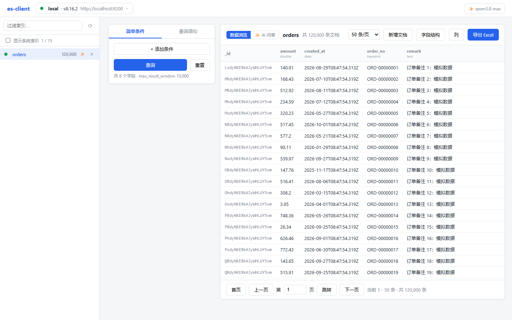
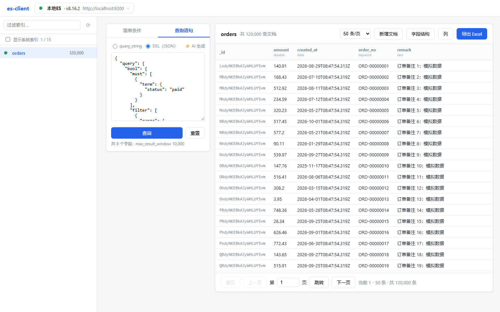
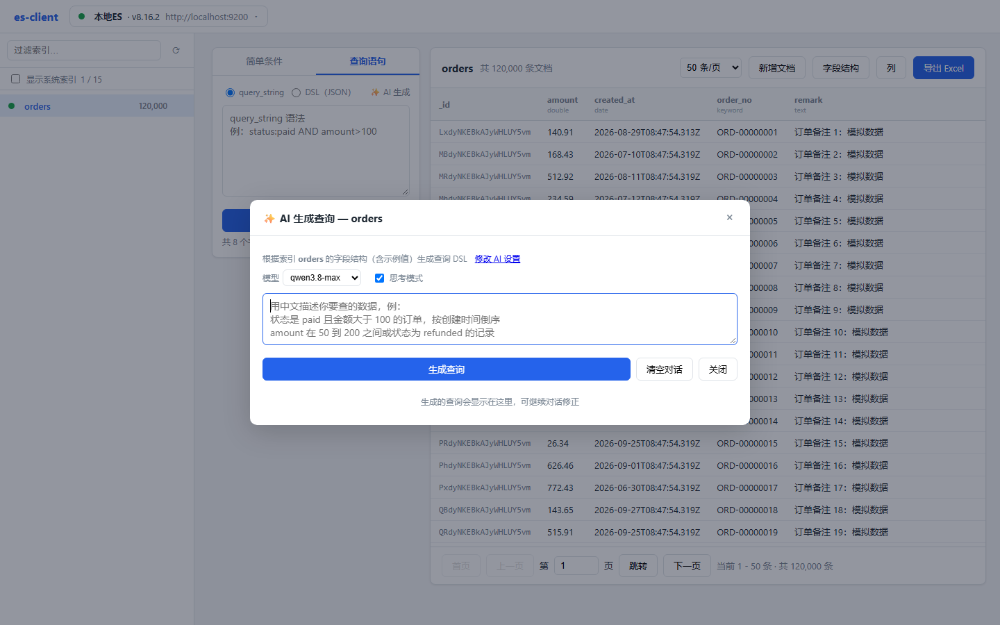
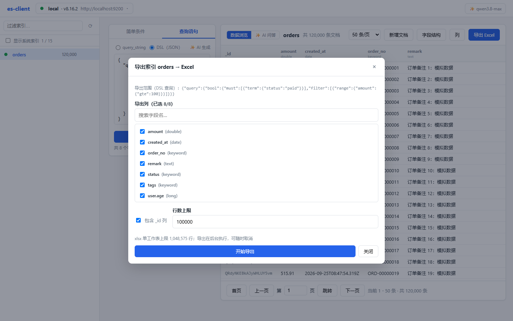
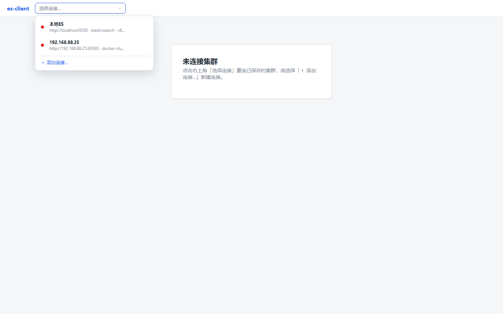

# es-client

轻量级 Elasticsearch 数据浏览与导出工具：连接集群、浏览索引与文档、构建查询、用自然语言生成 DSL、对索引数据 AI 问答、导出 Excel。

后端为 ASP.NET Core（.NET 10），前端为无框架的原生 JavaScript，全部由后端静态托管，单命令即可启动。

## 界面预览



**数据浏览**：左侧索引列表（支持过滤、显示/隐藏系统索引），右侧文档表格分页浏览。

<div>
  
  
</div>

**查询构建**：简单条件 / query_string / DSL(JSON) 三种模式；**AI 生成查询**：用自然语言描述需求，自动生成 DSL。

<div>
  
  
</div>

**导出 Excel**：选择导出列、行数上限，后台执行可随时取消；**连接管理**：多连接保存与一键切换。

## 功能特性

- **连接管理**：多集群连接保存、自动重连、顶栏下拉快速切换，自动探测集群名称与版本（支持 ES 7 / 8）
- **索引浏览**：索引列表过滤、文档数统计、系统索引显隐开关、索引删除
- **数据浏览**：分页浏览（可调页大小）、动态列配置、字段结构（mapping）查看、新增文档
- **查询构建**：
  - 简单条件：字段 + 操作符可视化拼接
  - query_string 语法
  - DSL(JSON)：直接编写完整查询请求体
  - **AI 生成**：自然语言 → DSL，支持 OpenAI 兼容接口的多模型配置与思考模式
- **AI 问答**：针对当前索引数据提问（计数、分布、汇总等），AI 生成查询后执行，流式回答并附结果表格；每个索引支持多会话，历史保存在服务端；回答中的查询 DSL 可一键填入查询面板
- **导出 Excel**：基于 MiniExcel 流式写出，可勾选导出列、设置行数上限（单表上限 1,048,575 行）、可选包含 `_id` 列，后台任务执行、随时取消

## 快速开始

### 1. 启动 Elasticsearch（已有集群可跳过）

仓库自带 [docker-compose.yml](docker-compose.yml)，一键启动两个本地测试集群（无安全模式）：

```bash
docker compose up -d   # es8 → localhost:9200，es7 → localhost:9201
```

### 2. 启动应用

```bash
dotnet run --project src/EsClient.Api
```

打开 http://localhost:5063 ，在顶栏下拉中选择「＋ 添加连接…」填入 ES 地址即可（默认 `http://localhost:9200`）。

### 3. 造测试数据（可选）

内置 [Seeder](src/Seeder/Program.cs) 造数工具，创建 `orders`（12 万条订单）、`weird`（脏数据边界用例）、`empty`（空索引）三个索引：

```bash
dotnet run --project src/Seeder -- --host http://localhost:9200 --count 120000
```

## AI 配置

点击**顶栏的 ✨ 模型标签** →「⚙ 管理模型配置…」，配置任意 OpenAI 兼容接口（如 DeepSeek、通义千问）的 BaseUrl / ApiKey / 模型名，支持保存多个模型配置并随时切换；「AI 生成查询」与「AI 问答」共用此处配置的当前模型。

## 配置说明

连接信息与 AI 配置保存在 `src/EsClient.Api/App_Data/` 下（运行时自动生成）：

- `connections.json`：ES 连接（含用户名/密码）
- `ai-settings.json`：AI 模型配置（含 ApiKey）
- `chats/`：AI 问答会话历史（按索引分文件）

> ⚠️ 该目录包含明文凭据，请勿分享给他人。

## 项目结构

```
src/
├── EsClient.Api/          # ASP.NET Core 后端 + 静态托管前端
│   ├── Controllers/       # 连接、索引、文档、导出、AI 接口
│   ├── Es/                # 轻量 ES HTTP 客户端（无官方 SDK 依赖）
│   ├── Services/          # 连接存储、查询构建、分页、导出任务等
│   └── wwwroot/           # 原生 JS 前端（无框架、无构建步骤）
└── Seeder/                # 测试数据造数工具
```
